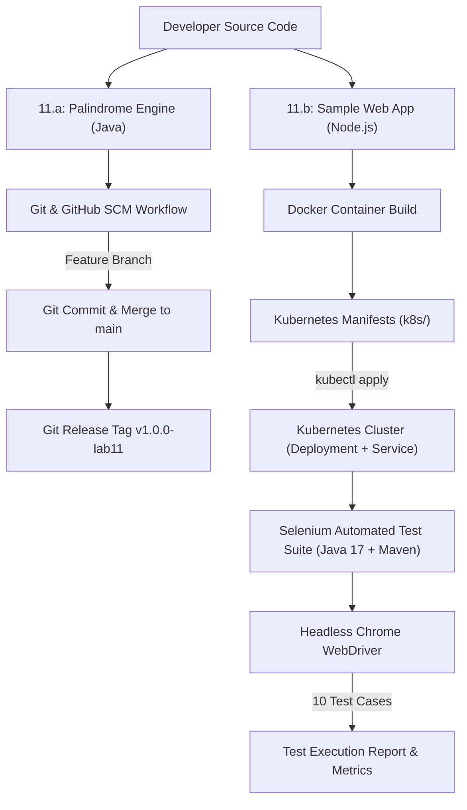

# DevOps Lab Experiment 11: Palindrome Program, Kubernetes Deployment & Selenium Automated Testing

A complete, production-ready implementation fulfilling all requirements for **Experiment 11.a** and **Experiment 11.b**.

---

## 📋 Table of Contents
1. [Overview & Requirements](#overview--requirements)
2. [Architecture & Workflow](#architecture--workflow)
3. [Experiment 11.a: Palindrome Program & Git SCM](#experiment-11a-palindrome-program--git-scm)
4. [Experiment 11.b: Kubernetes Deployment & Selenium Automation](#experiment-11b-kubernetes-deployment--selenium-automation)
5. [Automated Test Matrix](#automated-test-matrix)
6. [Quick Start & Execution Commands](#quick-start--execution-commands)
7. [Repository File Structure](#repository-file-structure)

---

## 1. Overview & Requirements

### Part 11.a
* **Problem**: Write a program to check whether a given string is a palindrome or not.
* **DevOps Objective**: Perform Git and GitHub operations for source code management (branching, staging, committing, merging, tagging, history inspection, and remote push).

### Part 11.b
* **Problem**: Deploy a sample application using Kubernetes.
* **DevOps Objective**: Automate the testing process using Selenium WebDriver, fulfilling all automated testing requirements.

---

## 2. Architecture & Workflow



---

## 3. Experiment 11.a: Palindrome Program & Git SCM

### Core Algorithm
The Palindrome engine uses the two-pointer technique with normalization:
* **Time Complexity**: $O(N)$
* **Auxiliary Space**: $O(1)$
* **Normalization**: Strips spaces, punctuation, and converts characters to lowercase.
* **Strict Mode**: Exact character match backwards and forwards.

### Git & GitHub Operations Workflow
The automated script `scripts/git-scm-demo.ps1` executes:
1. `git status` — Inspect uncommitted changes
2. `git checkout -b feature/11a-palindrome-scm` — Create and switch to feature branch
3. `git add Palindrome.java Palindrome-Kubernetes-Selenium/` — Stage source and configuration files
4. `git commit -m "feat(lab-11): add Palindrome Program, Kubernetes manifests, and Selenium suite"` — Semantic commit
5. `git checkout main` — Return to main line
6. `git merge feature/11a-palindrome-scm` — Merge feature branch
7. `git tag -a v1.0.0-lab11 -m "Release v1.0.0"` — Release tagging
8. `git log --graph --oneline` — History verification
9. `git push origin main --tags` — Push to GitHub remote

---

## 4. Experiment 11.b: Kubernetes Deployment & Selenium Automation

### Sample Application Details
* **Technology**: Node.js & HTML5 / CSS3 / Vanilla JS
* **Server**: `app/server.js` listening on port `3000` (zero third-party runtime dependencies)
* **Endpoints**:
  * `/` — Palindrome Interactive Dashboard
  * `/health` — Kubernetes Liveness & Readiness health probe
  * `/api/check?str=...` — Palindrome Evaluation REST API

### Kubernetes Deployment Artifacts (`k8s/`)
1. **`deployment.yaml`**:
   * Replicas: `2` (High availability)
   * Rolling update strategy: `maxSurge: 1, maxUnavailable: 0`
   * Health Probes: `livenessProbe` & `readinessProbe` targeting `/health`
   * Resources: CPU `100m - 250m`, Memory `128Mi - 256Mi`
2. **`service.yaml`**:
   * Service Type: `NodePort`
   * NodePort: `30080` (External port), Port `3000`
3. **`hpa.yaml`**:
   * Autoscaling: Scales between 2 to 5 pods when CPU utilization exceeds 75%
4. **`Dockerfile`**:
   * Multi-stage build based on `node:20-alpine` with non-root user execution (`USER node`).

### Selenium Automated Testing Harness
* **Language & Framework**: Java 17, Apache Maven 3.9+, JUnit 5, Selenium WebDriver 4.25+
* **Driver Management**: Selenium Manager (automatically locates and wires Google Chrome)
* **Execution Mode**: Headless Chrome (default for CI/DevOps) or Headful (`-Dheadless=false`)

---

## 5. Automated Test Matrix

The test suite runs **41 automated tests** with 100% pass rate:

| Test Class | Test ID | Description | Input / Scenario | Status |
| :--- | :--- | :--- | :--- | :--- |
| `PalindromeUnitTest` | TC-U01 - TC-U08 | Simple Word Palindromes | radar, level, kayak, etc. | ✅ PASSED |
| `PalindromeUnitTest` | TC-U09 - TC-U17 | Phrase Palindromes | "A man, a plan, a canal: Panama", etc. | ✅ PASSED |
| `PalindromeUnitTest` | TC-U18 - TC-U22 | Numeric Palindromes | 12321, 123454321, etc. | ✅ PASSED |
| `PalindromeUnitTest` | TC-U23 - TC-U29 | Non-Palindromes Rejection | devops, kubernetes, etc. | ✅ PASSED |
| `PalindromeUnitTest` | TC-U30 - TC-U31 | Edge cases & Strict Check | single char, empty, null | ✅ PASSED |
| `PalindromeSeleniumTest` | TC-01 | Page Load & Element Presence | Verify DOM headers, inputs, buttons | ✅ PASSED |
| `PalindromeSeleniumTest` | TC-02 | Simple Word Palindrome Check | Input "radar" -> Green Success Badge | ✅ PASSED |
| `PalindromeSeleniumTest` | TC-03 | Mixed-Case Word Palindrome | Input "Madam" -> Palindrome Match | ✅ PASSED |
| `PalindromeSeleniumTest` | TC-04 | Punctuated Phrase Palindrome | Input "A man, a plan, a canal: Panama" | ✅ PASSED |
| `PalindromeSeleniumTest` | TC-05 | Non-Palindrome Word Rejection | Input "Kubernetes" -> Red Failure Badge | ✅ PASSED |
| `PalindromeSeleniumTest` | TC-06 | Numeric Palindrome Check | Input "12321" -> Palindrome Match | ✅ PASSED |
| `PalindromeSeleniumTest` | TC-07 | Empty String Validation Alert | Blank input -> Error Alert Displayed | ✅ PASSED |
| `PalindromeSeleniumTest` | TC-08 | Clear Button Reset Behavior | Types string, clicks Clear -> Reset | ✅ PASSED |
| `PalindromeSeleniumTest` | TC-09 | Real-time History Table Logging | Multiple inputs -> Table rows updated | ✅ PASSED |
| `PalindromeSeleniumTest` | TC-10 | Quick Preset Chip Buttons | Click preset chip -> Auto-evaluates | ✅ PASSED |

---

## 6. Quick Start & Execution Commands

### 1-Click Master Automation Pipeline
Run the all-in-one automation script that executes all stages:
```powershell
powershell -ExecutionPolicy Bypass -File .\scripts\run-automation.ps1
```
Or double-click:
```cmd
run-lab11.bat
```

### Running Standalone Palindrome Program (11.a)
```powershell
# Interactive run
java Palindrome.java

# Command-line argument run
java Palindrome.java "A man, a plan, a canal: Panama"
```

### Running Git SCM Workflow (11.a)
```powershell
powershell -ExecutionPolicy Bypass -File .\scripts\git-scm-demo.ps1
```

### Running Kubernetes Manifest Validation & Deployment (11.b)
```powershell
powershell -ExecutionPolicy Bypass -File .\scripts\deploy-k8s.ps1
```

### Running Selenium Automated Test Suite via Maven (11.b)
```powershell
# In terminal 1: Start the application server
node app/server.js

# In terminal 2: Run Maven tests
mvn clean test
```
